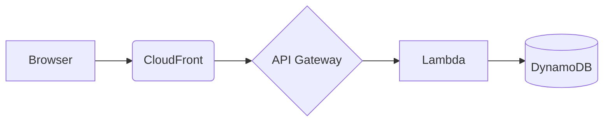
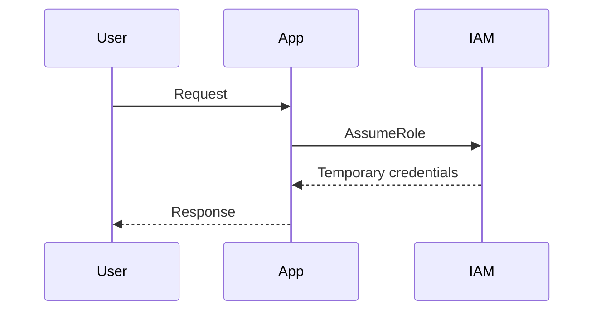

# Sample - Every Block in One Post

This post uses **every block** the theme supports. Code windows start open; click the title bar or the red dot to collapse one. Inline `code`, ==highlights==, <kbd>Cmd</kbd> + <kbd>K</kbd> and [links](https://example.com) all work.

## 1. Code windows

A fenced block becomes a macOS window. Add a title and how it starts after the language.

```hcl title="main.tf"
resource "aws_s3_bucket" "logs" {
  bucket = "cybertechmind-secure-logs"

  tags = {
    Environment = "prod"
  }
}

resource "aws_s3_bucket_public_access_block" "logs" {
  bucket              = aws_s3_bucket.logs.id
  block_public_acls   = true
  block_public_policy = true
}
```

The leading `$ ` is not copied:

```bash
$ npm install -g aws-cdk
$ cdk bootstrap
$ cdk deploy --all
```

Choose how a block starts with `open`, `preview` or `closed`:

```json title="policy.json" open
{
  "Version": "2012-10-17",
  "Statement": [
    { "Effect": "Allow", "Action": "s3:GetObject", "Resource": "arn:aws:s3:::my-bucket/*" }
  ]
}
```

## 2. Code tabs

::: tabs
```javascript title="Node.js"
import { S3Client, ListBucketsCommand } from "@aws-sdk/client-s3";
const s3 = new S3Client({ region: "us-east-1" });
const out = await s3.send(new ListBucketsCommand({}));
console.log(out.Buckets);
```
```python title="Python"
import boto3
s3 = boto3.client("s3")
print([b["Name"] for b in s3.list_buckets()["Buckets"]])
```
```bash title="AWS CLI"
aws s3api list-buckets --query "Buckets[].Name" --output text
```
:::

## 3. Mermaid diagrams





## 4. Callouts

> [!NOTE] A neutral note for extra context.

> [!TIP] Use IAM roles instead of long-lived access keys.

> [!WARNING] Never commit credentials. Rotate any key that was ever pushed.

::: danger
A public S3 bucket can leak customer data within minutes.
:::

::: security
Turn on CloudTrail in every region and ship the logs to a separate account.
:::

## 5. Image with caption

A title in quotes becomes the caption. Click the image to zoom.


## 6. Image slider

::: slider autoplay=5000


:::

## 7. Tables

Add `{sortable filter sticky}` on the line right after a table for extra features.

| Service | Latency (ms) | Monthly cost ($) | Best for |
|---|---|---|---|
| AWS Lambda | 45 | 12 | Event-driven APIs |
| EC2 | 12 | 85 | Long-running workloads |
| Fargate | 80 | 60 | Containers without servers |
| App Runner | 65 | 40 | Simple web apps |
{sortable filter}

## 8. Accordion (FAQ)

::: details What is the principle of least privilege?
Give every user and service only the permissions it needs, and nothing more.
:::

::: details How often should I rotate access keys?
At least every 90 days. Better: use IAM roles with temporary credentials.
:::

## 9. Numbered steps

::: steps
1. Create the S3 bucket with `block_public_acls = true`.
2. Attach a least-privilege IAM policy to the application role.
3. Enable CloudTrail data events for the bucket.
4. Alert on any ==PutBucketPolicy== call.
:::

## 10. Video, lists and quotes

Paste a YouTube link on its own line to embed it:

https://www.youtube.com/watch?v=dQw4w9WgXcQ

- A bullet point
- Another one
  - A nested point
- Last one

> "Security is a process, not a product." - Bruce Schneier

---

That is every block.
