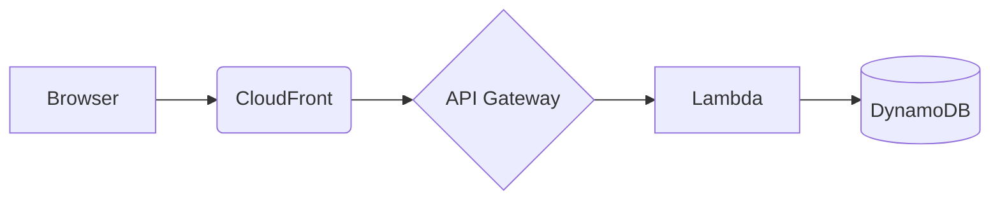

# Designing <system> on AWS: architecture, IaC and cost

The goals, the constraints and the traffic you designed for.

## Architecture



## Infrastructure as code

::: tabs
```hcl title="Terraform"
resource "aws_s3_bucket" "site" {
  bucket = "<BUCKET_NAME>"
}
```
```typescript title="CDK"
new s3.Bucket(this, "Site", { blockPublicAccess: s3.BlockPublicAccess.BLOCK_ALL });
```
:::

## Security checklist

::: details Is everything encrypted and logged?
Enable S3 default encryption, TLS only, CloudTrail in all regions and GuardDuty.
:::

## Cost estimate

| Service | Monthly ($) | Notes |
|---|---|---|
| Lambda | 12 | 1M requests |
| DynamoDB | 20 | On demand |
{sortable}

> [!TIP] Add a budget alarm before you deploy anything.
