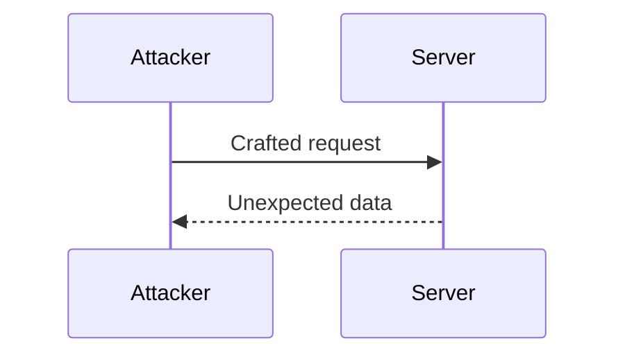

# <Vulnerability or technique>: how it works and how to fix it

> [!DANGER] Educational use only. Test only systems you own or have written permission to test.

## Summary

What it is, the impact (confidentiality, integrity, availability) and a severity rating (CVSS if known).

## Attack flow



## Proof of concept (lab only)

```python title="poc.py"
import requests
print(requests.get("https://lab.example.test/health").status_code)
```

## Detection

| Signal | Where to look | Example |
|---|---|---|
| Unusual requests | WAF / access logs | Repeated 4xx from one IP |
{sortable}

## Mitigation

::: security
Apply the fix, add a regression test and monitor for the signal above.
:::

## References

- Vendor advisory
- OWASP page
